# DSO202 Practical 2 Report

**Implementing Persistent Storage for a Stateful Application in Kubernetes**

## 1. Objective

In Practical 1 every Pod was disposable, so losing one did not matter. In this practical I worked with workloads where the data is the important part. I learned how PersistentVolumes, PersistentVolumeClaims and StorageClasses decide where data is stored and what happens to it. I then used StatefulSets to give each replica its own name, DNS record and volume. At the end I ran PostgreSQL as a StatefulSet and checked that its rows were still there after the Pod was deleted.

This practical covers Unit I sections 1.2.5, 1.4.1, 1.4.2, 1.4.3 and 1.5.3, and Unit II sections 2.1.1, 2.1.2, 2.1.3 and 2.1.4. It mainly addresses LO4 and also reinforces LO1, LO2 and LO3.

## 2. Environment

| Item | Version |
|---|---|
| Operating system | Pop!_OS 22.04 LTS |
| Docker | 28.4.0 |
| kind | v0.32.0 |
| kubectl client | v1.34.1 |
| Cluster Kubernetes version | v1.36.1 |
| PostgreSQL image | postgres:18-alpine (running PostgreSQL 18.6) |

I made two changes from the guide:

- I stored the static volume in `/home/tandinzangmo/dso202-p2-storage` instead of `/tmp/dso202-p2-storage`, because Docker refused to mount the `/tmp` path. The guide allows a different path as long as Docker can share it. Section 5 explains the error.
- My kubectl client is v1.34.1, which is older than the guide's minimum of v1.35. kubectl warned about the version difference, but all the commands worked.

I used the main cluster file. The fallback cluster file was not needed, because the node names were applied correctly. I did not attempt the extension tasks.

## 3. Procedure and Observations

The text output for each stage is also saved in the `evidence/` folder.

### Stage 0: Prerequisites

I checked my tools, created the storage directory and stopped my other clusters to free memory. The first attempts at this stage gave errors, which are covered in section 5.

**What this shows:** the tools were available and the storage directory existed before the cluster was created.

### Stage 1: Cluster, namespace and storage landscape

I created the three node cluster, applied the namespace, quota, limits and retaining StorageClass, and located the storage provisioner.

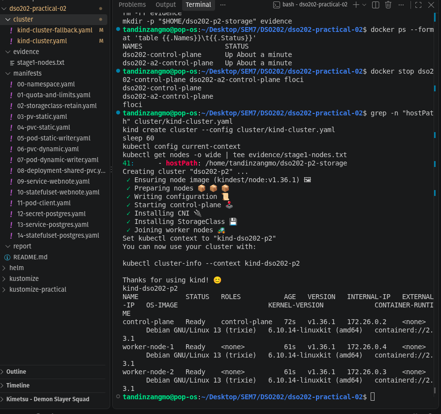

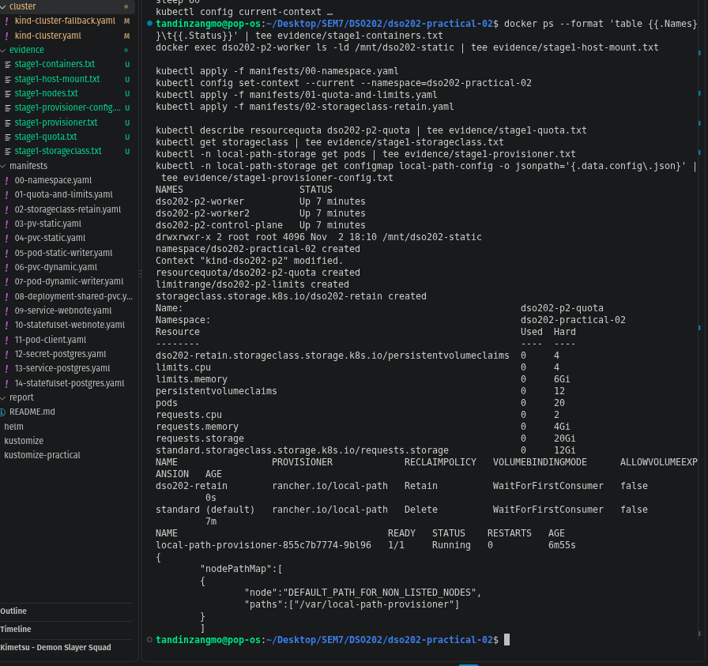

**What this shows:** the cluster has both the `standard` and `dso202-retain` classes, both use the `rancher.io/local-path` provisioner, and dynamic volumes are created under `/var/local-path-provisioner` on the nodes.

### Stage 2: Static provisioning and Retain

I created a PV by hand, claimed it and ran a Pod that adds a line to `ledger.txt` each time it starts. I then deleted and recreated the Pod, the claim and the PV.

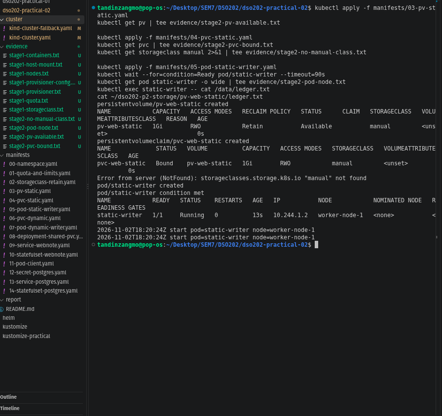

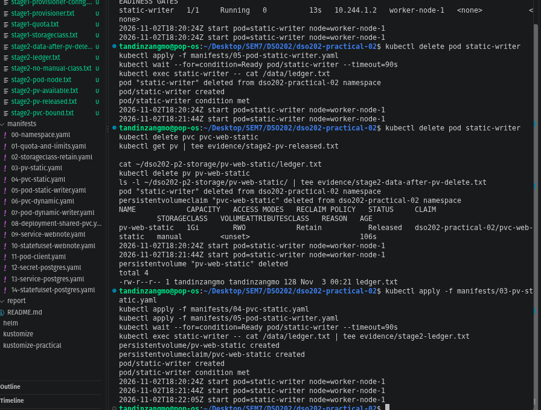

**What this shows:** the claim bound immediately and the Pod was placed on `worker-node-1` with no nodeSelector. After the claim was deleted the PV became Released. Deleting the PV did not delete the file, and the new PV, claim and Pod read all three lines, so the PV object is only a description of the storage.

### Stage 3: Dynamic provisioning

I created a claim with no Pod, added a Pod, checked the volume's size and tried to resize it. Then I deleted the Pod and claim.

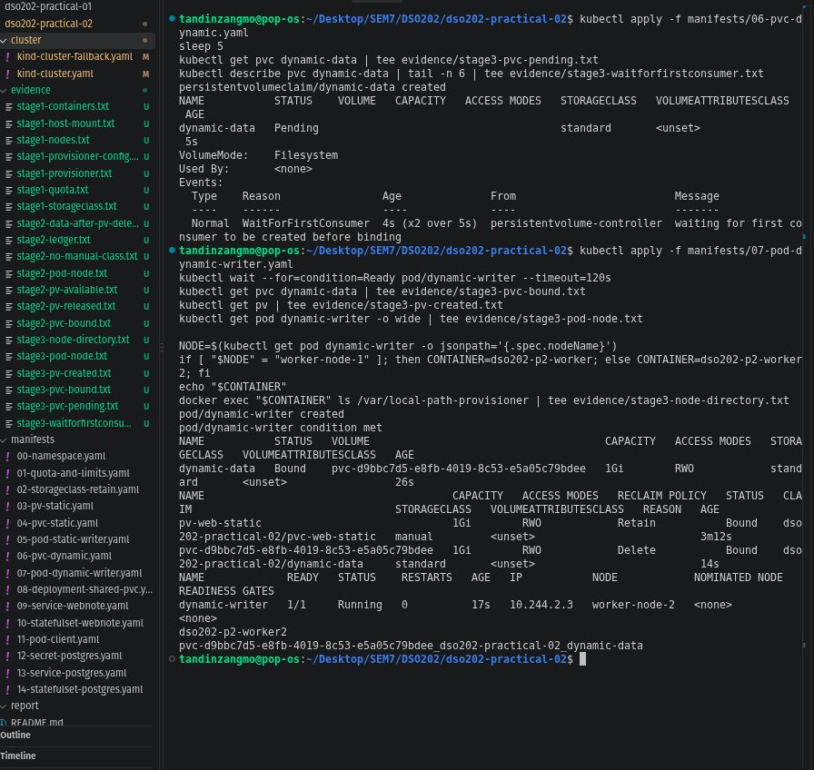

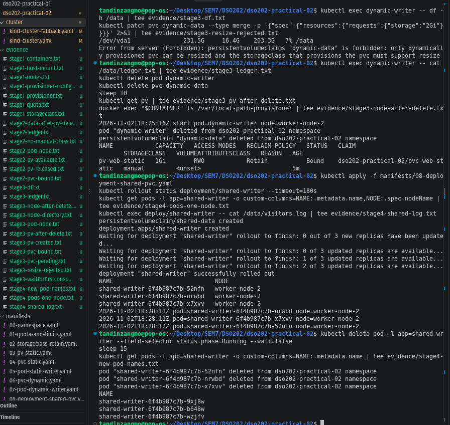

**What this shows:** the claim stayed Pending until a Pod needed it, and then a PV was created automatically with reclaim policy Delete. The 1Gi claim showed a 231.5G filesystem, so the size is not enforced here, and the resize was rejected as Forbidden. Deleting the claim removed the volume and its directory on `worker-node-2`. `pv-web-static` still appeared in my `kubectl get pv` output, unlike the guide's sample, because my Stage 2 volume was still bound.

### Stage 4: Why a Deployment cannot own state

This stage was built to fail. I pointed a Deployment with three replicas at one claim. The screenshot above (the lower half) and the one below show the result.

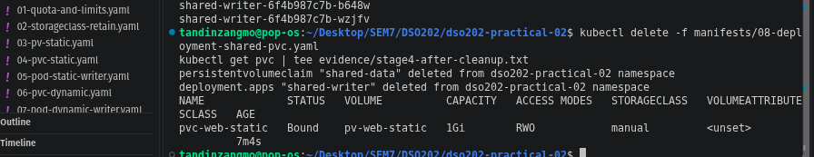

The rollout finishing does not mean this setup is correct. I observed three problems:

1. **The volume decided the placement.** All three Pods ran on `worker-node-2`, even though the Deployment has no node preference, because the volume exists on one node only.
2. **There was one set of data, not three.** All three Pods wrote into the same `visitors.log`. A database in this position could corrupt its data.
3. **No replica kept an identity.** After I deleted the Pods, the names ending in `52nfn`, `nrwbd` and `x7xvv` were replaced by `9xj8w`, `b648w` and `wzjfv`. Nothing could refer to the same replica before and after the restart.

This cluster also hides a problem. Because ReadWriteOnce means one node and not one Pod, the setup ran without complaint here, while on a cloud cluster it would usually give a multi-attach error.

### Stage 5: StatefulSets and stable identity

I created a headless Service and a StatefulSet with three replicas, tested DNS from a client Pod, added a note to one Pod's volume and deleted another Pod.

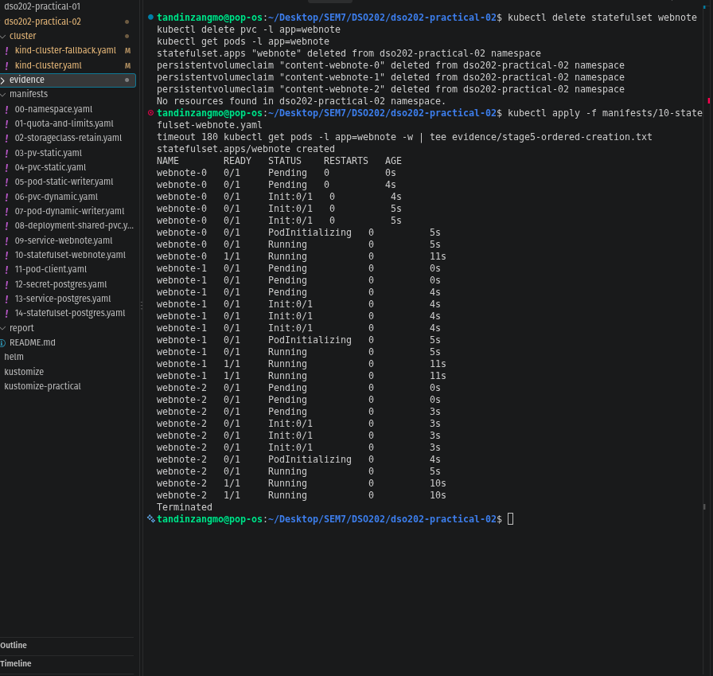

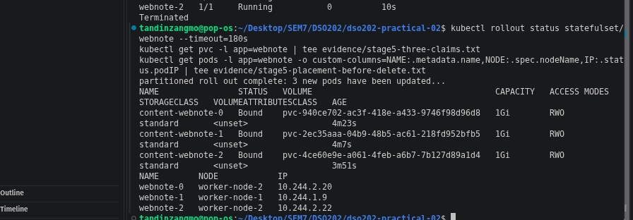

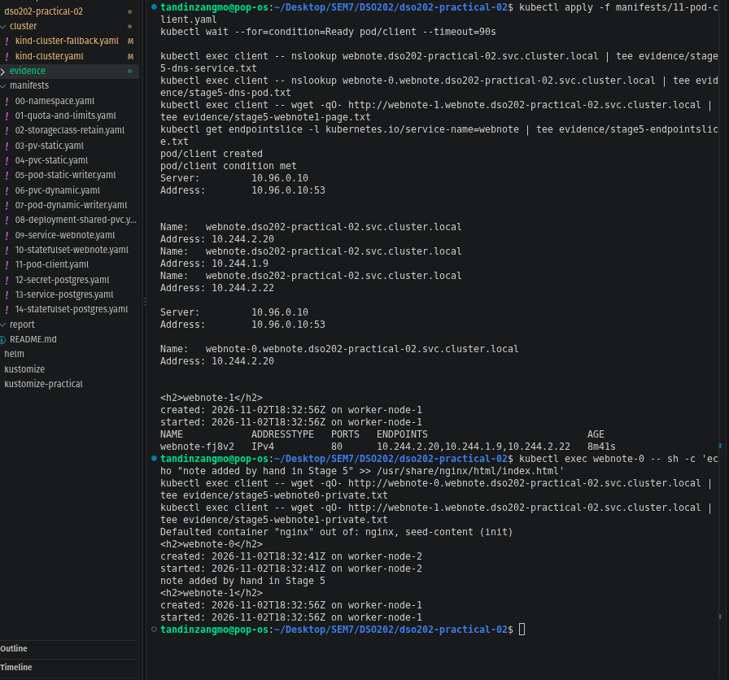

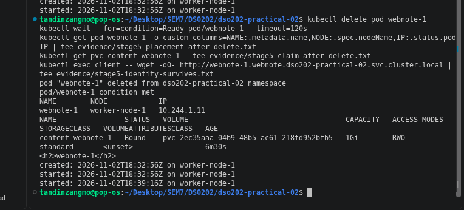

**What this shows:** each of the four StatefulSet guarantees appeared in my output.

- **Stable name:** the replacement Pod was still called `webnote-1`.
- **Stable storage:** it reused `content-webnote-1`. The `created:` time stayed at 18:32:56 and a new `started:` line was added at 18:39:16.
- **Stable network identity:** the IP changed from 10.244.1.9 to 10.244.1.11, but the DNS name stayed the same. The Service name returned three addresses, and `webnote-0` returned only its own, 10.244.2.20.
- **Ordered operations:** `webnote-1` only started after `webnote-0` was ready, and `webnote-2` only started after `webnote-1`.

The note I added appeared only on `webnote-0`, so the volumes are private.

### Stage 6: Scaling, retention and ordered updates

I scaled from 3 replicas to 4, then 2, then back to 3. I then updated nginx with a partition, and finally deleted and recreated the StatefulSet.

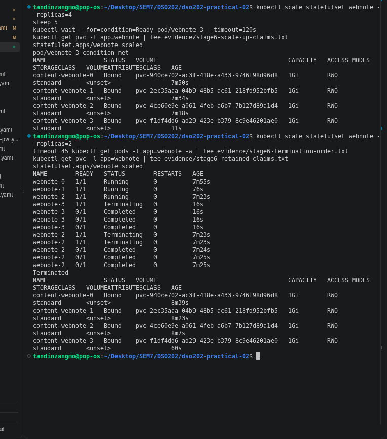

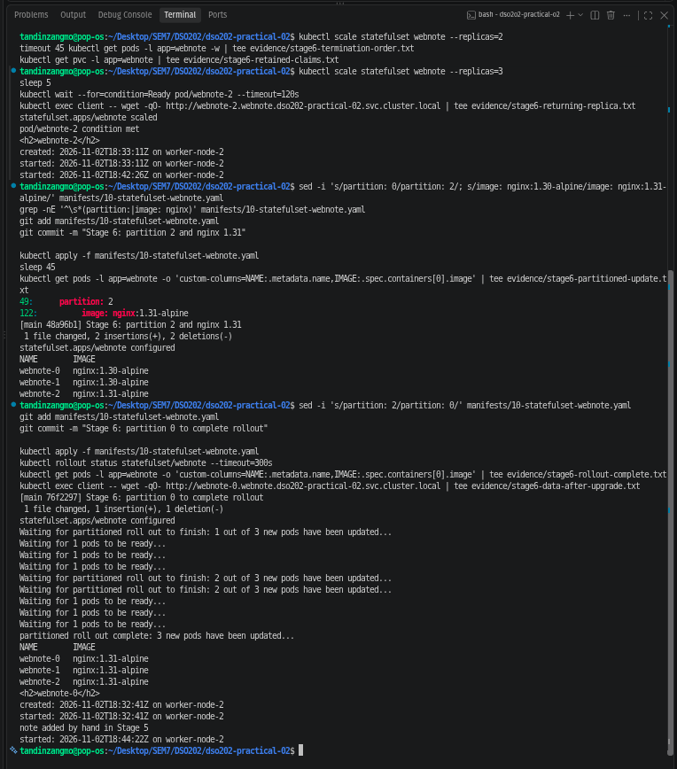

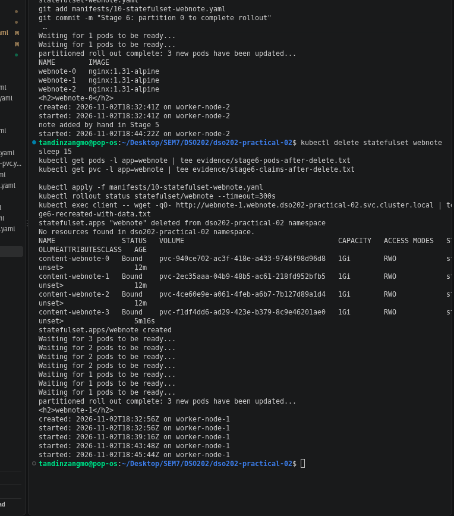

**What this shows:** Pods were removed from the highest number down, `webnote-3` first and then `webnote-2`. With 2 Pods running, all 4 claims remained. When `webnote-2` came back it had its original `created:` time of 18:33:11. With `partition: 2` only `webnote-2` moved to `nginx:1.31-alpine`, and setting it back to 0 updated the others, while `webnote-0` kept its Stage 5 note. After I deleted and recreated the StatefulSet, the 4 claims were still there and `webnote-1` still had its original `created:` time.

The partition and image changes are in my commits `48a96b1` and `76f2297`. I made them in the manifest file so that the repository still describes the cluster.

### Stage 7: PostgreSQL

I created the Secret and two Services, deployed PostgreSQL on the `dso202-retain` class, added three rows and deleted the Pod.

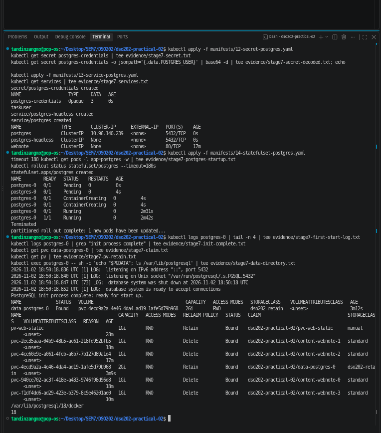

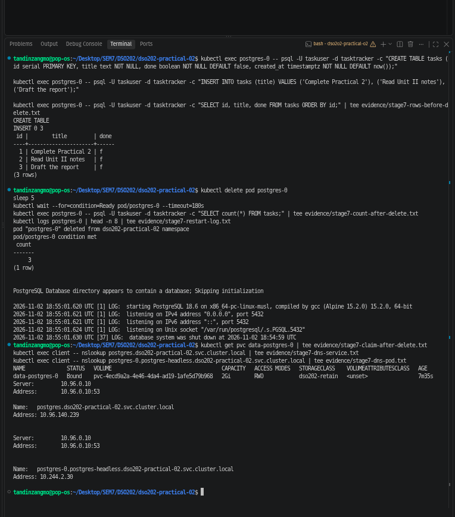

**What this shows:** the Pod was Running at 2m31s, after waiting for the image download, and became 1/1 at 2m42s, so the readiness probe held it back until the database could answer. The data directory is `/var/lib/postgresql/18/docker`, under the mount point. After the Pod was deleted, `SELECT count(*)` still returned 3. The log says the directory already contains a database and skipped initialization. The `postgres` name resolved to the Service IP 10.96.140.239, and the `postgres-0` name resolved to the Pod IP 10.244.2.30. The Secret value decoded to `taskuser` with one command, so a Secret is encoded and not encrypted.

### Stage 8: Cleanup and the cost of Retain

I saved the final state and an SQL dump first. Then I deleted the workloads, the claims, the static PV and the cluster.

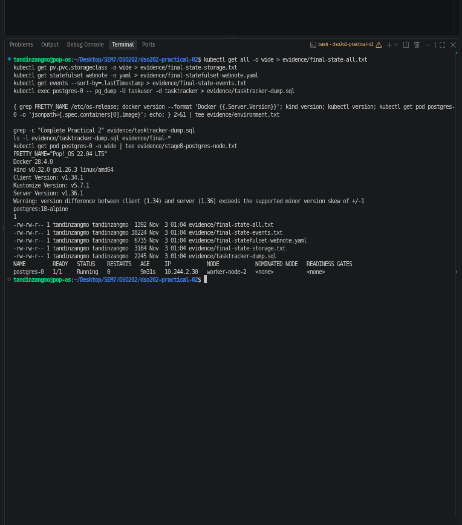

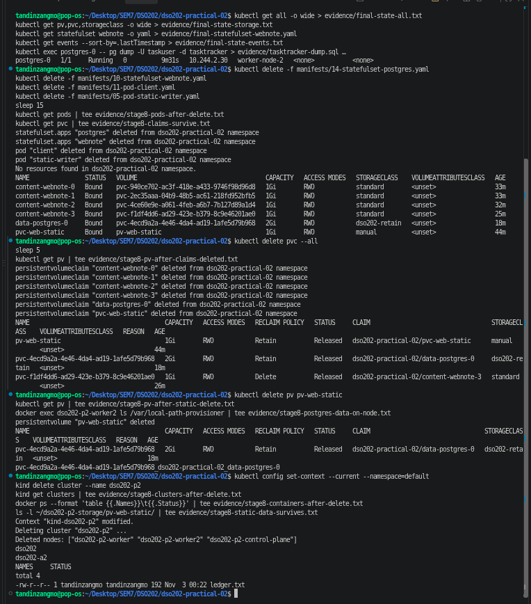

**What this shows:** deleting the workloads left all 6 claims behind, because kubectl only removes what is in the manifests. After I deleted the claims, the two Retain volumes showed Released. My first `kubectl get pv` ran before the deletion had finished, so it also lists `content-webnote-3`, still being removed. The next listing shows only the PostgreSQL volume left, after I deleted `pv-web-static` myself, so all four `standard` volumes were gone. The PostgreSQL directory was still on `worker-node-2`. After the cluster was deleted, `ledger.txt` was still in my home folder because it was never inside the cluster. The PostgreSQL volume was inside a node, so it went with the cluster, which is why the SQL dump is the real backup.

## 4. Analysis

**1. Why was the Stage 3 claim Pending while the Stage 2 claim bound at once?**

The field is `volumeBindingMode`. The `standard` class in my StorageClass output uses WaitForFirstConsumer, so the claim waits until a Pod needs it. This is designed so that the volume is created on the node where the Pod will run, instead of on a node the Pod might not be able to use. The Stage 2 claim uses the class name `manual`, which has no StorageClass object (my `kubectl get storageclass manual` returned NotFound), so no binding mode applied and it matched the existing PV straight away.

**2. Which object decided whether the data survived?**

In Stage 3 it was the `standard` StorageClass, whose `reclaimPolicy` of Delete was inherited by the PV, as my `kubectl get pv` output shows. In Stage 2 the hand-written PV had its own `persistentVolumeReclaimPolicy` of Retain. In a real organisation the StorageClass would normally be chosen by a cluster administrator or platform team, not by the developer writing the claim.

**3. Why were all three Stage 4 replicas on one node?**

All the replicas use one claim, and that claim is bound to a volume that physically exists on one node. The scheduler therefore could only place the Pods on `worker-node-2`, as my output shows. On a managed cloud cluster with a zonal disk, the volume attaches to one node at a time, so any replica scheduled on another node would not start and its events would report a multi-attach error.

**4. What is the DNS name of the second replica?**

Numbering starts at 0, so the second replica is `webnote-1`, and its name is `webnote-1.webnote.dso202-practical-02.svc.cluster.local`. For it to resolve, these objects must exist: the namespace `dso202-practical-02`, the headless Service `webnote`, the StatefulSet `webnote` with `serviceName: webnote`, a Ready Pod `webnote-1`, and the EndpointSlice for the Service. Cluster DNS must also be running.

**5. What happened to the claims when scaling 4, 2, 3?**

Scaling to 4 created `content-webnote-3`. Scaling down to 2 removed Pods but kept all 4 claims. Scaling back to 3 reattached `content-webnote-2`, shown by its original `created:` time, while `content-webnote-3` stayed unused. The two fields are `persistentVolumeClaimRetentionPolicy.whenScaled` and `persistentVolumeClaimRetentionPolicy.whenDeleted`, and both default to Retain.

**6. Why mount at `/var/lib/postgresql` and not at the data directory?**

From PostgreSQL 18, the image keeps its data in a version numbered subdirectory, which in my output is `/var/lib/postgresql/18/docker`. Mounting the parent keeps the data inside the volume and leaves the data directory one level down. If a volume is mounted directly at the data directory and it is not empty, initdb refuses to initialize it, so the container keeps restarting with an error saying the directory is not empty.

**7. What does a StatefulSet not provide for a database?**

It does not replicate data, as each replica has its own unrelated volume. Replication is handled by the database itself, usually managed by an Operator. It also does not take backups, because a surviving volume can still be destroyed by one wrong command. Backups need a tool such as `pg_dump`, stored outside the cluster, which I did with `tasktracker-dump.sql`.

**8. Why were the volumes Released and not Available?**

The claim was gone, but the volume could still hold that workload's data, so Kubernetes will not give it to a new claim. My output shows the CLAIM column still naming the deleted claims. To return the storage to service, an administrator must deal with the old data, then either remove the volume's `claimRef` or delete and recreate the PV. In Stage 2 I deleted and recreated the PV.

## 5. Reflection

**Errors I met and how I diagnosed them.**

*Connection refused and Pod not found.* My first command gave `connection refused`, and when I ran it again it gave `pods "static-writer" not found`.

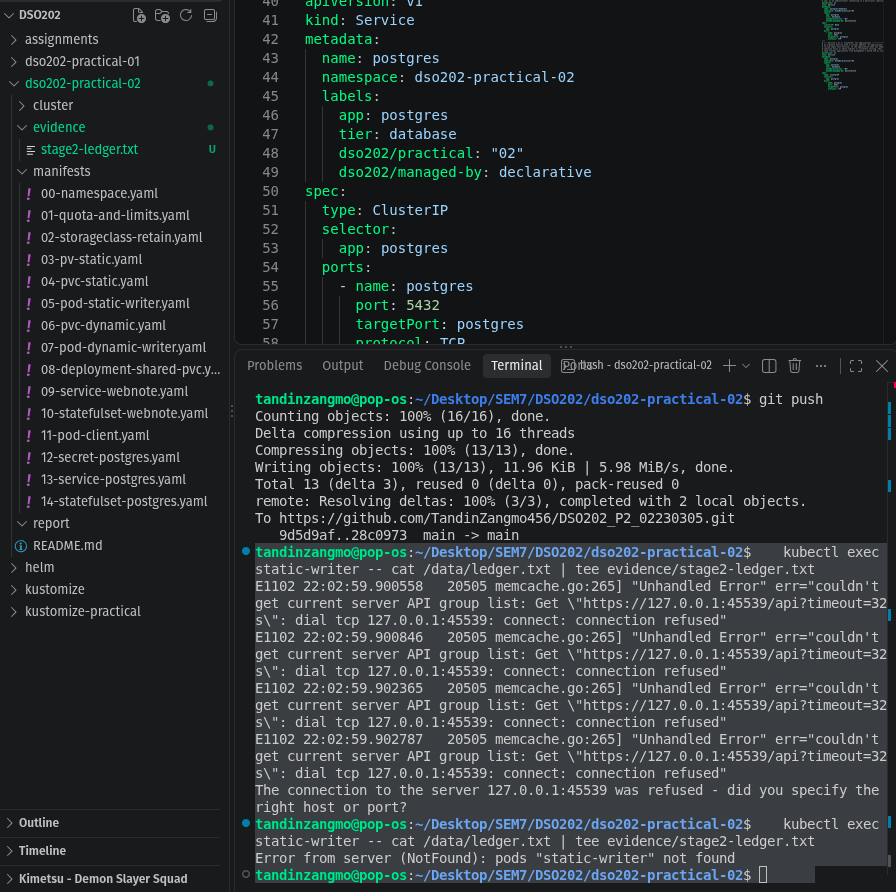

I ran `kind get clusters`, `kubectl config current-context` and `docker ps`. These showed that `dso202-p2` did not exist and that kubectl was pointing at `kind-dso202`. So my YAML was not the problem. I was on the wrong cluster and had not yet run the practical on this machine.

*Mounts denied.* `kind create cluster` failed with `mounts denied`.

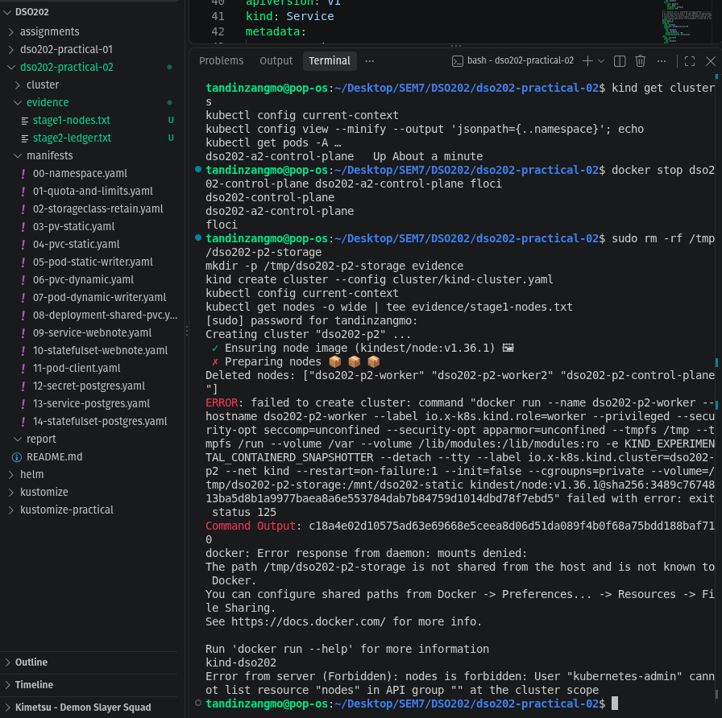

The message said `/tmp/dso202-p2-storage` was not shared with Docker. I moved the storage under my home folder, updated both cluster files, and the cluster was created. The `Forbidden` error after it was only because kubectl was still on my old context, since the new cluster had not been created.

*TLS handshake timeout.* After the next cluster creation, `kubectl get nodes` failed with a TLS handshake timeout.

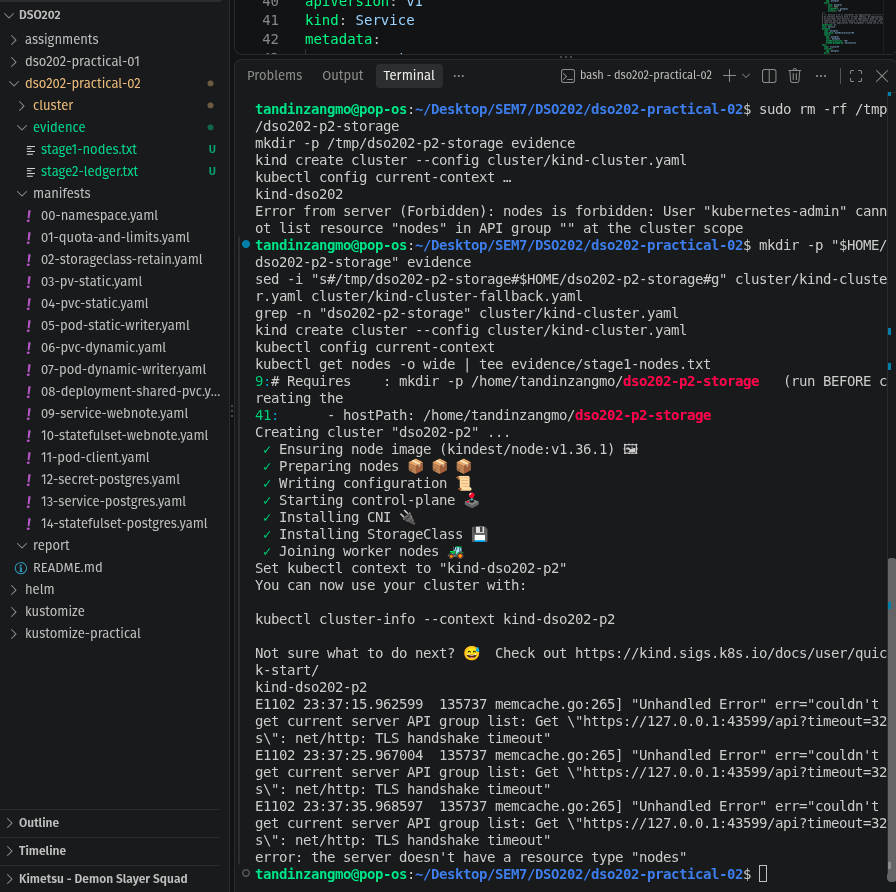

The cluster had been created and the context was correct, so I suspected the API server was not responding yet or my laptop was short on resources. I deleted the cluster and its data, restarted Docker, stopped my other containers with `docker stop`, and waited 60 seconds before checking the nodes. All three then showed Ready. I did not confirm the exact cause, because I started again instead of measuring resources.

*Watch too short.* In Stage 5 my 90 second watch stopped before `webnote-2` was created, because the first image download took about a minute.

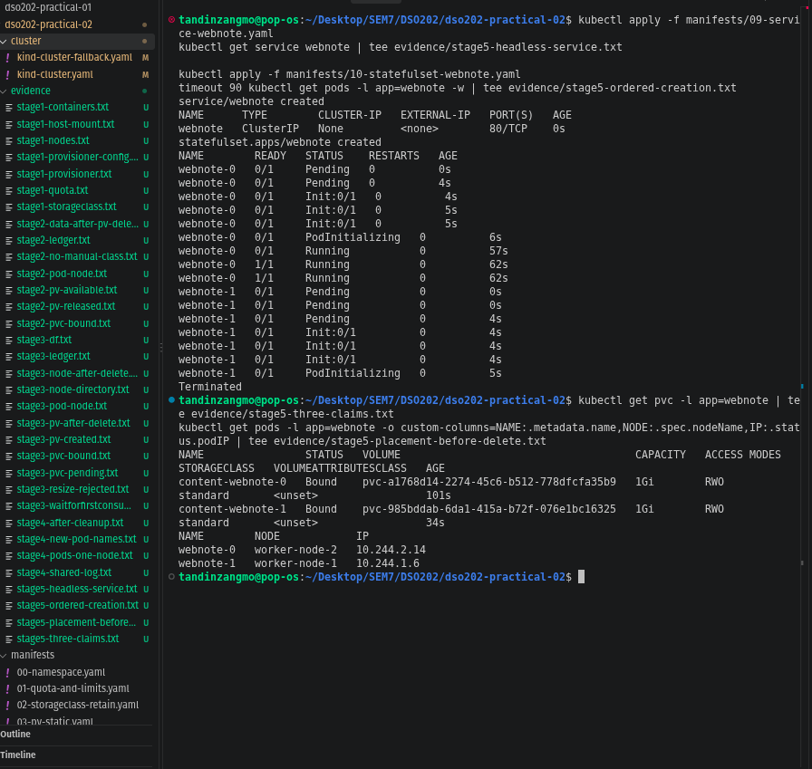

My evidence only showed two Pods and two claims, so I deleted the StatefulSet and its claims and ran it again with a longer watch. `Terminated` in the output only means the `timeout` command stopped the watch.